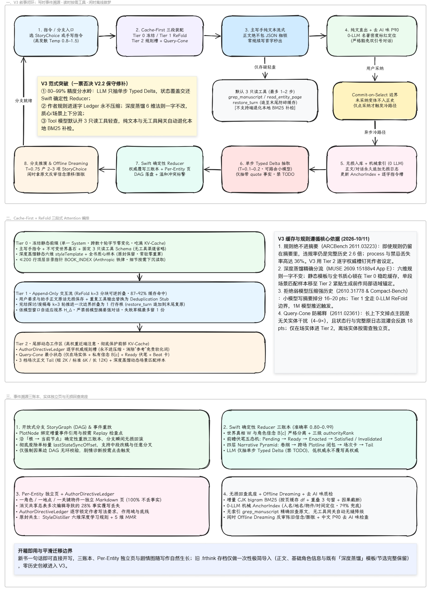

<div align="center">

# Frthink for iOS

**面向中文长篇小说创作的原生 iOS AI 叙事工作台**

零第三方依赖 · 纯 SwiftUI 构建 · 事件溯源叙事记忆 · Cache-First 上下文编排 · 端到端本地加密

[](https://developer.apple.com/ios/)
[](https://swift.org)
[](https://developer.apple.com/xcode/swiftui/)
[](#工程结构)
[](https://github.com/Reylumina/Frthink-iOS/actions/workflows/ios.yml)

<p align="center">
  <a href="#架构总览">架构总览</a> •
  <a href="#核心功能">核心功能</a> •
  <a href="#叙事记忆与上下文引擎">叙事引擎</a> •
  <a href="#文风提炼与审校">文风与审校</a> •
  <a href="#模型与协议支持">模型支持</a> •
  <a href="#隐私与本地存储">安全存储</a> •
  <a href="#构建与安装">构建安装</a>
</p>

</div>

---

Frthink for iOS 是 Android 应用 Frthink v0.8.213 的 SwiftUI 移植。原应用由 Fr33 开发，包名为 `com.frthink.app`。本仓库为非官方移植，与原作者无隶属关系。原应用及其提示词版权归原作者所有。

在保留原版核心创作流、`.frthink` 存档导入导出与提示词体系的基础上，新版重构了**现代 Agent-Native 叙事记忆引擎**：将**高帧率流式码字机**、**写时事件溯源三账本（事实 / 认知 / 伏笔）**、**读时 Cache-First + ReFold 可逆折叠**、**按需只读工具闭环**与**六维文风提炼 + 纯端侧去 AI 味体检**融为一体，解决长篇连载中“吃设定、角色全知泄密、AI 腔调浓重、上下文前缀频繁失效”四大核心痛点。

---

## 架构总览

<div align="center">
  
</div>

### 五大核心设计准则

1. **LLM 单步抽取 + Swift 确定性 Reducer 裁决**：摒弃“让大模型自行改写整张状态总表”或“由小模型后台重写历史摘要”的脆弱做法。LLM 仅在低温度（`T=0.1–0.2`）下抽取带原文 `quote` 锚点的单步增量（`Typed Delta`，严禁生成臆断 TODO），所有状态覆写、权威等级校验与分支重放均由纯 Swift 确定性状态机（`NarrativeStateReducer`）执行。
2. **一实体一独立档案页 + 逐字作者法则槽**：放弃单一共享大表，每位角色、组织、地点、关键物品拥有独立的 Markdown 档案页（`EntityPage`）；所有作者硬性要求与写作禁忌存入独立的 `AuthorDirectiveLedger`，**永不经过摘要模型改写或压缩**。
3. **Cache-First + ReFold $k=3$ 可逆折叠**：将静态系统指令、六维文风模板与 `≤200 行` 顶层目录指针 `BOOK_INDEX` 锁定在 `Tier 0` 冻结前缀（跨轮字节零变化，100% 命中服务端 KV Cache）；中间交互流每 $k=3$ 轮推进一次可逆折叠边界（`Tier 1` Append-Only），动态规则与在场状态统一收拢至近端高注意力的 `Tier 2` 尾部工作区。
4. **纯文本流式主写手 + 默认 3 项只读工具**：前台主写手始终输出纯文本流式正文（绝不套入 JSON/XML 结构枷锁）；对支持 Tool Calling 的模型默认开放最多 1–2 步只读工具轻查（`grep_manuscript` / `read_entity_page` / `restore_turn`），无工具网关自动无缝降级至端侧增量 BM25 + 机械锚点（`AnchorIndex`）预检索。
5. **Commit-on-Select 边界与支线严格隔离**：未采纳的草稿与多变体绝不污染世界正史；切换或回退剧情分支时，全书共享设定（`entityPages` 与全局法则）保持唯一真源，支线事实、私有认知、伏笔状态与金字塔摘要随当前分支头节点精确重放与回滚。

---

## 核心功能

### 1. 创作台与流式码字机
- **33ms 帧控流式输出**：底层基于 `NSTextStorage` 末段增量替换与 TextKit 两端对齐排版（默认 `1.2x` 行高），长文流式输出与思维链（CoT）卡片实时展开零抖动。
- **多变体分支与 Commit-on-Select**：同一轮指令支持多次重生成、左右切换变体与独立折叠思考过程；仅在点击“插入/追加正文”时才将新节拍原子提交至叙事图谱，并与系统级撤销/重做（`UndoManager`）及撤回指令深度联动，一键同步回滚正文与支线记忆账本。
- **分支走向推演（Story Choices）**：卡文时可按需（`T=0.75`）基于当前在场状态、未决伏笔与作者法则推演 2–3 条差异化剧情走向，一键填入指令栏。
- **叙事视角（POV）切换**：写作台右上角菜单支持随时指定当前章节的 POV 视角角色，自动启用该角色的私有认知边界过滤。
- **窗口化大文本编辑**：正文按页加密落盘，全屏正文编辑器仅加载书末活跃窗口，百万字书稿秒开秒存。

### 2. 三段式世界工作台（档案 · 剧情 · 规则）
- **设定档案（Entity Pages）**：支持按角色、组织、地点、物品分类管理独立档案页；可从正文或对话气泡右键“提取设定”自动建档去重，支持关系一跳联想、别名归一化、声音档案（`voiceProfile`）、行为底线（`hardBoundaries`）及温和冲突确认条。
- **单轨线性主路径剧情图谱（Story Graph）**：采用 `Focus + Context` 单轨线性主路径呈现当前因果节拍链，在分叉点通过内联菜单切换平行支线，随时从任意历史节点分叉续写或追加规划节拍。
- **五态伏笔追踪（Prospective Threads）**：独立管理伏笔生命周期：`待埋设 (Pending) → 就绪可触发 (Ready) → 已触发 (Enacted，单次伏笔自动锁止防重复触发) → 已回收 (Satisfied) / 已废弃 (Invalidated)`，支持关联原文证据锚点与超期未推进提醒。
- **作者法则（Author Directives）**：集中管理全局与分支作用域的硬性写法要求、人设禁区与世界铁律，逐字锁定注入 `Tier 2` 尾部工作区。

### 3. 阅读器、长篇译制与共享宇宙
- **沉浸式分页阅读器**：按块懒加载正文页，支持章节目录自动识别、全文搜索、书签管理与排版参数调节。
- **长篇分段对照翻译**：内置滑窗上下文与术语一致性翻译工作流，支持原文与译文分段对照及独立导入导出。
- **共享宇宙（Universe）**：跨书稿共享核心世界观设定，方便系列作品与多卷联动。

---

## 叙事记忆与上下文引擎

### 三段式 Attention 与 KV-Cache 编排

| 分段 | 位置与缓存策略 | 精确载荷清单 |
|---|---|---|
| **Tier 0 · 冻结静态前缀** | 单一 `system` 消息（跨轮字节零变化，吃满服务端 KV-Cache） | 主写手核心指令 + 不可变世界基石 + **六维文风提炼静态 `styleTemplate` + 全书质心样本** + **`≤200 行` 顶层目录指针 `BOOK_INDEX`** + 固定 3 只读工具 Schema（无工具端自动省略） |
| **Tier 1 · Append-Only 交互流** | 中间对话历史（严格只追加；每 $k=3$ 轮推进一次 ReFold 边界） | 永久保留用户与助手正文原话；重复工具输出替换为去重存根（`Deduplication Stub`）；已完结探讨轮次折叠为 1 行带步骤索引的 `progress` 存根；依模型窗口自适应调整视界 |
| **Tier 2 · 尾部动态工作区** | 紧贴末尾最新 `user` 指令（近端高权重注意力，不扰前部缓存） | ① **`AuthorDirectiveLedger` 逐字规则槽**（无“仅作参考”软化词）<br>② **Query-Cone 最小充分状态**（本场在场实体 + **纯符号 1-hop 关联离场实体（上限 2 个）** + POV 私有信念 $B[c]$ + `Ready` 就绪伏笔）<br>③ **3 档场次正文 Tail**（`2K / 6K / 12K`）+ **动态场景匹配文风样本** |

### 事件溯源三账本与三级权威等级
- **账本 A · 世界事实与认知分离（`WorldFactEvent` & `EpistemicBelief`）**：严格区分全球客观真相 $W$ 与角色主观认知 $B[c]$。每条事实携带三级权威等级（**作者手改指令 `authorDirective` > 正文落盘事实 `canonProseQuote` > AI 单步推断 `inferredByAI`**），低权威推断永不覆盖高权威设定。
- **账本 B · 前瞻伏笔五态机（`ProspectiveThread`）**：仅在满足激活条件（`Ready`）时唤醒进入 `Tier 2` 工作区，避免“一记住伏笔就提前强行引爆”或“仅靠精确标题匹配导致无法消解”。
- **账本 C · 四层叙事金字塔（`NarrativePyramid`）+ 机械锚点（`AnchorIndex`）**：滚动归纳「远期卷纲（每卷 1 行）→ 跨场 `Plotline` 原子闭包 → 近期场次卡 → 现场 Tail」，配合零模型成本的纯 Swift 机械锚点抽取（专名、称谓、物件、数字、时间原文定位）与带 `+0.05` 近因决胜的按页增量 CJK Bigram BM25 索引。

### 原生只读工具契约（Tool Calling 默认开启 · 无工具端自动降级）

| 工具名 | 参数签名 | 作用与因果保护边界 |
|---|---|---|
| `grep_manuscript` | `pattern: String, contextLines?: Int, regex?: Bool` | 直查全书分页原稿，严格受 `continuationAnchor` 因果截断保护（续写锚点之后的未来正文不可见，严防剧透），返回带章节/页定位的上下文片段 |
| `read_entity_page` | `entityId: String, section?: String` | 按需读取被 Query-Cone 裁剪在外的离场角色、组织、地点、物件独立档案页全文及关联原文引文锚点 |
| `restore_turn` | `stepRange: String` | 从无损日志中恢复被 ReFold 折叠的早期对话轮次，作为新消息追加至上下文尾部，绝不回改历史前缀以保护 KV-Cache |

---

## 文风提炼与审校

- **六维文风提炼（Style Distiller）**：从样章中深度提炼句法节奏、叙事腔调、感官密度、对白特征与正反技法，支持 Markdown 富文本排版预览；结合五维 MMR 多样性选样，将全书质心样本固定在 `Tier 0` 静态前缀，并将当前场景语域（动作 / 对白 / 心理 / 景物）最匹配的范例动态注入 `Tier 2` 尾部。
- **纯端侧去 AI 味体检（Prose Style Linter）**：对标中文名著 P90 散文基线，毫秒级检测旁白中的空洞代词、指代量词冗余、无支撑“不是…而是…”句式及旁白破折号密度；**严格豁免双引号与直角引号内的角色对白**，零 API 成本直接在卡片中标红定位问题原句。
- **闲时记忆自审（Offline Dreaming）**：按需对照原始正文与无损日志反向审计三账本与设定档案页，捕获已被推翻的陈旧信念、档案冗余膨胀与超期未推进伏笔，提供“同步事实 / 保留信息差 / 查看档案 / 忽略 / 一键安全整理”精细化治理，并支持对离线挂起节点（`pendingSyncNodeIDs`）一键补抽。

---

## 模型与协议支持

内置三大原生协议客户端与统一流式传输层（`LLMHTTPTransport`），支持 `<think>` 标签流式实时剥离、表驱动思考等级控制，以及**流式/非流式全链路 Token 用量统计**（`LLMTokenUsage`：优先解析各家服务端返回的 `usage` / `usageMetadata` 含缓存命中 token，缺失或流式中断时自动按 `TokenEstimator` 本地估算兜底，并实时持久化至全局累计消耗）：

| 协议 / 供应方 | 默认端点与核心特性 |
|---|---|
| **DeepSeek** | `https://api.deepseek.com` · 原生支持 `deepseek-chat` / `deepseek-reasoner`、`reasoning_content` 思维链流式分流与多轮工具回合回传、`/beta` Prefix 续写 |
| **Anthropic (Claude)** | `https://api.anthropic.com` · 原生 `/v1/messages` 协议、`x-api-key` 鉴权、Extended Thinking 预算控制、`≥1024 tokens` 自动挂载 `ephemeral` Prompt Caching 断点 |
| **Google Gemini** | `https://generativelanguage.googleapis.com/v1beta` · 原生 REST 协议、`thinkingConfig` 思考等级控制、`thought` 思考部分流与原生 `functionDeclarations` |
| **OpenRouter** | `https://openrouter.ai/api/v1` · 统一 `reasoning` 参数与多厂商模型路由 |
| **OpenAI 兼容网关** | 内置 DeepSeek、Kimi、Zai/GLM、Qwen、豆包、混元、MiniMax、OpenCode Go、Ollama Cloud、Grok、Mistral 等 13 项预设与独立 Key 绑定；遇到不支持 `stream_options`、`tools` 或 `prefill` 的网关自动降级重试 |

设置页内置各服务商官方品牌矢量/高清图标（DeepSeek、OpenRouter、Anthropic、Gemini 及 16 家主流大模型厂商图标），按服务商类型与端点地址自动匹配。所有品牌商标归各自所有者所有。

---

## 隐私与本地存储

- **零云端后台 & Keychain 隔离**：API Key 仅保存在 iOS 系统 `Keychain` 中，绝不写入普通配置文件或存档；应用不内置任何第三方统计 SDK，无中转服务器。
- **AES-256-GCM 全盘加密 + 增量 WAL 日志**：
  - 书稿正文采用分页密文存储（`body.pages/*.bin` + `body.meta.json`），阅读器与编辑器按页按需解密。
  - 叙事工作区（`projects/<id>/narrative/`）采用**6 域 O(1) 版本号判脏**与**增量加密预写日志（`story_graph.wal`，`FRWL` + AES-256-GCM 帧格式）**：日常节点提交仅追加百字节级 WAL 密文帧，满 40 帧自动压实回主图并支持异常断电尾帧自愈；重放检查点独立拆分至 `checkpoints/<node>.json`（上限保留 12 份关键分支检查点），彻底消除每次保存的全量 JSON 重写。
- **开放导入与归档**：完整兼容 `.frthink` 压缩归档（RFC1952 gzip）导入与导出；正文与译文支持 UTF-8 / UTF-16 / GB18030 自动识别导入及纯文本 `.txt` 导出。

---

## 工程结构

工程仅依赖 iOS 系统原生框架（`SwiftUI`、`Foundation`、`UIKit`、`CryptoKit`、`Security`、`Compression`），零第三方依赖：

```text
ios/
  Frthink.xcodeproj/             Xcode 工程（文件同步分组）
  Frthink/
    App/                         应用入口、五栏 Tab 导航与运行时自检 (SelfCheck / NarrativeSelfCheck)
    Core/
      Archive*.swift             .frthink 存档模型、快照导出、恢复导入与 RFC1952 gzip
      Narrative/                 事件溯源三账本、StoryGraph DAG、StoryGraphWAL 增量加密日志、
                                 ReFold 可逆折叠、Query-Cone 上下文编排、3 项原生只读工具、
                                 单步 Typed Delta 抽取、四层金字塔归纳、去 AI 味体检与离线自审
      Prompts/                   P01–P64 提示词体系、六维文风提炼 (StyleDistiller) 与预算规划
      LLM/                       OpenAI 兼容 / Anthropic / Gemini 原生客户端、流式 <think> 拆分器、
                                 LLMTokenUsage 全链路 Token 统计与本地估算器
      Store/                     AES-256-GCM 加密文件存储、正文分页引擎、增量 BM25 索引、Keychain
      Models/                    项目、世界、章节、共享宇宙与设置数据模型
      Design/                    iOS 26 Liquid Glass 自适应材质、主题 Token 与 TextKit 两端对齐排版
    Features/
      Library/                   书架、作品封面与回收站
      Writer/                    流式码字机、多变体卡片、分支推演、选区改写与窗口化正文编辑器
      World/                     三段式世界工作台（档案 · 剧情 · 规则）、文风提炼与生成工作流
      Narrative/                 设定档案页、单轨线性主路径剧情图、五态伏笔、作者法则与记忆自审视图
      Reader/                    分页阅读器、章节目录、全文搜索与排版设置
      Translation/               长篇分段翻译与原文/译文对照
      Universe/                  跨书稿共享宇宙设定库
      Settings/                  模型供应方、提示词管理、语料库、Token 用量统计与归档管理
```

---

## 构建与安装

### 环境要求

| 项目 | 要求 |
|---|---|
| **最低系统版本** | iOS 17.0（iOS 26+ 自动启用原生 Liquid Glass 液态玻璃材质，iOS 17–25 自动回落至系统毛玻璃材质） |
| **构建环境** | macOS + Xcode 16.0 / Xcode 26.3+，Swift 5.10+ |
| **第三方依赖** | 无（纯系统框架） |

### 从源码编译

```bash
git clone https://github.com/Reylumina/Frthink-iOS.git
cd Frthink-iOS

# 使用 Xcode 打开
open ios/Frthink.xcodeproj

# 或使用命令行编译模拟器产物
xcodebuild -project ios/Frthink.xcodeproj -scheme Frthink \
  -destination 'generic/platform=iOS Simulator' build
```

### 安装未签名 IPA

仓库内置 GitHub Actions 自动化构建流水线（[`.github/workflows/ios.yml`](.github/workflows/ios.yml)），编译完成后会产出未签名安装包 `Frthink-unsigned.ipa`，可通过 **AltStore**、**SideStore**、**Sideloadly** 或 **TrollStore** 自签安装至 iPhone / iPad。

---

## 署名与致谢

| 项目 | 内容 |
|---|---|
| **原作** | Fr33 |
| **原应用** | Frthink v0.8.213（Android，`com.frthink.app`） |
| **原版署名** | `Power by Fr33` |

原版设置页中的版本行与 `Power by Fr33` 署名行在本移植版中原样保留。感谢原作者 Fr33 的产品设计与提示词工程。
