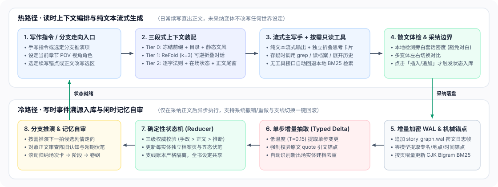

# Frthink for iOS

[](https://developer.apple.com/ios/)
[](https://swift.org)
[](https://github.com/Reylumina/Frthink-iOS/actions/workflows/ios.yml)

Frthink for iOS（下称 **Frthink**）是基于 Android 应用 Frthink v0.8.213（由 Fr33 开发，包名 `com.frthink.app`）开发的非官方 SwiftUI 移植版，与原作者无隶属关系；原应用及其提示词的版权均归原作者所有。

Frthink 在保留原版创作流、提示词体系与 `.frthink` 存档兼容的基础上，重构了面向长篇小说的叙事记忆与上下文引擎。

## 1. 创作与叙事闭环



创作流程分为读时热路径（步骤 1–4）与写时冷路径（步骤 5–8），以“采纳正文”作为状态入库的分界线：

- **流式续写与多变体切换**：支持流式生成正文与独立折叠的思考过程卡片；同一轮指令可多次重生成并左右切换候选变体。
- **采纳时提交（Commit-on-Select）**：未采纳的候选草稿不会写入世界状态；仅在点击“插入”或“追加正文”时更新叙事图谱，并与系统撤销/重做（`UndoManager`）及撤回指令联动回滚。
- **分支走向推演**：根据当前在场角色、未决伏笔与写作规则生成 2–3 条候选剧情走向，可一键填入输入框。
- **叙事视角（POV）切换**：指定当前章节的视角角色后，自动按该角色的已知信息过滤上下文，隔离未知秘密。
- **单步增量抽取与确定性状态机**：采纳正文后，后台以低温度抽取带原文引文锚点（`quote`）的单步变更，由本地状态机按权威等级更新档案、认知与伏笔，不在主写作请求中夹带 JSON 格式约束。

## 2. 上下文编排与工具检索


上下文按变更频率划分为三层，固定前部缓存并把高频变化项收拢至末尾：

- **三段式上下文窗口**：
  - `Tier 0`（静态前缀）：系统指令、静态文风模板、全书质心样本与顶层目录索引（`BOOK_INDEX`），保持跨轮次前缀一致以复用服务端 KV 缓存。
  - `Tier 1`（可逆折叠对话流）：保留最近 3 轮完整对话与工具轨迹；早期轮次按固定步长折叠为单行进展存根，并对重复工具输出自动去重。
  - `Tier 2`（尾部动态工作区）：组装逐字作者法则、在场实体及一跳关联离场实体、视角角色私有认知、就绪伏笔、场景匹配文风样本与书末正文窗口（`2K / 6K / 12K`）。
- **按需只读工具与本地回退**：
  - `grep_manuscript`：检索全书分页原稿，受续写锚点因果截断保护（锚点之后的未来正文不可见）。
  - `read_entity_page`：按需查阅未在场的角色、组织、地点或物品独立档案页全文。
  - `restore_turn`：将早期折叠的对话轮次追加至上下文末尾复原，不修改历史前缀。
  - 不支持 Tool Calling 的接口自动切换为本地按页增量 BM25 与专名锚点（`AnchorIndex`）预检索。

## 3. 世界工作台、文风审校与存储


世界页精简为「档案 · 剧情 · 规则」三栏工作台：

- **设定档案（Entity Pages）**：按角色、组织、地点、物品分类管理独立档案页。支持从正文或对话气泡右键“提取设定”自动建档去重、别名归并、关系一跳联想及设定冲突确认。
- **剧情图谱（Story Graph）**：以单轨主路径展示当前因果节拍，在分叉节点可通过内联菜单切换平行支线，或从任意历史节点分叉续写。切换或回退支线时自动隔离支线事实与伏笔，同时保留全书通用设定档案与全局法则。
- **五态伏笔与四层金字塔**：伏笔按 `待埋设 → 就绪 → 已触发 → 已回收 / 已废弃` 流转（单次伏笔触发后自动锁止）；已发生节拍逐级归纳为近期场次卡、阶段剧情线与卷纲摘要。
- **作者法则（Author Directives）**：管理全局或分支范围的硬性写作要求与禁区，生成时逐字注入 `Tier 2`，不经摘要压缩。
- **文风提炼、散文体检与记忆自审**：
  - **文风提炼**：从样章提炼句法节奏、叙事腔调、感官细节与对白特征，按当前场景语域（动作、对白、心理、景物）动态匹配原文范例。
  - **散文体检**：在本地检测旁白中的高频套话与冗余句式密度（自动跳过引号内的角色对白），在界面标出对应原句。
  - **记忆自审**：核对正文与设定档案，检查陈旧认知、冗余条目与超期伏笔，支持逐条处理或一键安全整理。
- **阅读、翻译与共享宇宙**：阅读器支持章节目录识别、全文搜索、书签定位与排版调节；翻译页支持分段原文与译文对照翻译；共享宇宙支持跨书稿复用设定词条。

## 4. 模型供应方

在设置页配置服务地址与模型。API Key 保存在 iOS 系统 Keychain 中，不写入普通文件或备份存档。支持服务端返回用量与本地估算结合的累计 Token 统计。

| 供应方 | 默认地址 | 说明 |
|---|---|---|
| DeepSeek | `https://api.deepseek.com` | 支持 `deepseek-chat` / `deepseek-reasoner`、思维链分流与 Prefix 续写 |
| Anthropic | `https://api.anthropic.com` | 原生 `/v1/messages` 协议，支持 Extended Thinking 与 Prompt Caching |
| Google Gemini | `https://generativelanguage.googleapis.com/v1beta` | 原生 REST 协议，支持 `thinkingConfig` 与工具调用 |
| OpenRouter | `https://openrouter.ai/api/v1` | 支持统一 `reasoning` 参数与多模型路由 |
| OpenAI 兼容 | 自定义或内置预设 | 内置 Kimi、GLM、Qwen、豆包、混元、MiniMax、OpenCode Go、Ollama Cloud、Grok、Mistral 等预设 |

## 5. 数据与存储

- **本地加密与增量日志**：本地书稿正文分页（`body.pages/*.bin`）、叙事三账本（`ledgers.json`）、剧情图谱增量日志（`story_graph.wal`）与检查点快照（`checkpoints/*.json`）均使用 `AES-256-GCM` 加密存储，主密钥保存在系统 Keychain。
- **导入与导出**：兼容原版 `.frthink` 归档导入与导出；正文与译文支持 UTF-8、UTF-16、GB18030 编码文本导入及 `.txt` 导出。

## 6. 构建与安装

### 环境要求
- iOS 17.0 及以上（iOS 26 及以上启用原生 Liquid Glass 材质，iOS 17–25 使用系统毛玻璃材质）
- Xcode 16.0 及以上，无第三方依赖

### 编译

```bash
git clone -b feat/narrative-engine https://github.com/Reylumina/Frthink-iOS.git
cd Frthink-iOS

xcodebuild -project ios/Frthink.xcodeproj -scheme Frthink \
  -destination 'generic/platform=iOS Simulator' build
```

GitHub Actions 工作流（[`.github/workflows/ios.yml`](.github/workflows/ios.yml)）可直接构建未签名安装包 `Frthink-unsigned.ipa`，通过 AltStore、SideStore、Sideloadly 或 TrollStore 安装至设备。

## 署名

| 项目 | 内容 |
|---|---|
| 原作 | Fr33 |
| 原应用 | Frthink v0.8.213（Android，`com.frthink.app`） |
| 原版署名 | `Power by Fr33` |

原版设置页中的版本行和 `Power by Fr33` 署名行在 Frthink 中原样保留。
