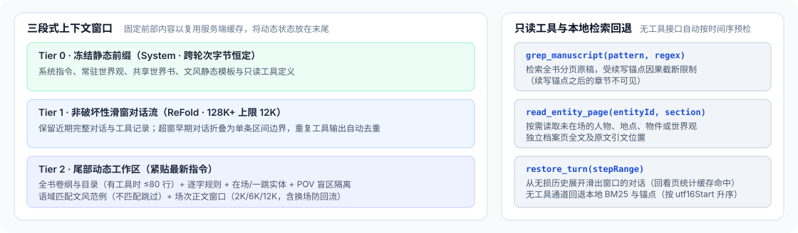
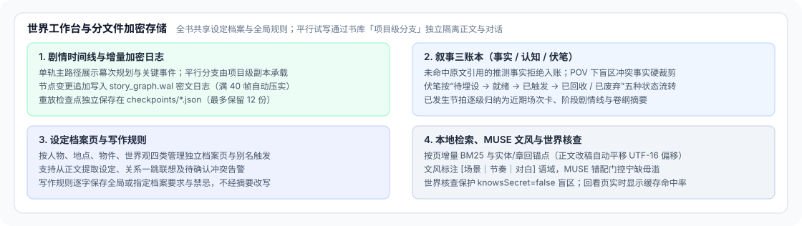

# Frthink for iOS

[](https://developer.apple.com/ios/)
[](https://swift.org)
[](https://github.com/Reylumina/Frthink-iOS/actions/workflows/ios.yml)

Frthink for iOS（下称 **Frthink**）是基于 Android 应用 Frthink v0.8.213（由 Fr33 开发，包名 `com.frthink.app`）开发的非官方 SwiftUI 移植版，与原作者无隶属关系；原应用及其提示词的版权均归原作者所有。

Frthink 在保留原版创作流、提示词体系与 `.frthink` 存档兼容的基础上，重构了面向长篇小说的叙事记忆与上下文引擎。

## 1. 创作与叙事流程


创作流程分为读时生成（步骤 1–4）与写时入库（步骤 5–8），以点击「插入」或「追加正文」作为状态提交的分界线：

- **流式续写与多版本切换**：支持流式生成正文与独立折叠的思考过程卡片；同一轮指令可多次重生成并左右切换候选版本。
- **采纳时提交**：未采纳的候选草稿不会改写世界状态；仅在采纳正文后才提交剧情节点，并随系统撤销、重做及撤回指令同步回滚全部支线账本。
- **语境感知选区改写**：选中正文片段改写时，自动带入前后文衔接、在场档案约束、写作规则与仿写模板；正文前中段编辑与改写后同步平移 `continuationAnchor`、`sceneBoundaryOffset`、剧情节点锚点及 `AnchorIndex` 的 UTF-16 偏移，防止长文定位漂移。
- **场景切换剪枝与防回流**：支持手动标定或后台自动检测转场边界（`sceneBoundaryOffset`），仅将当前场次正文放入尾部窗口并同步过滤跨场检索，避免前场高刺激原文持续回流干扰续写。
- **分支走向推演**：结合在场角色、未决伏笔、进行中关键事件与写作规则生成 2–3 条候选走向，可一键填入输入框。
- **叙事视角（POV）硬隔离**：指定当前章节的视角角色后，在上下文组装前硬裁剪与视角角色盲区（`knowsSecret == false`）冲突的客观事实，隔离未公开秘密。
- **单步增量抽取与全书两阶段原子同步**：
  - **实时采纳冷同步**：采纳正文后携带 `200` 字只读前情与相关性优先事件列表，后台以关闭思考与 `0.15` 低温调用「世界更新模型」抽取单步增量；世界任务统一锁定 `0.2` 低温非流式。
  - **全书两阶段专精同步**：按 `3500` 字切片 + `250` 字只读前情重叠分块，阶段 1 专精四类档案与精确动态事实（带本段原文 grounding 门控与整句预算归并）、阶段 2 基于已定型实体专精剧情事件、五态伏笔与角色认知；请求级短编号（`E1`/`EV1`/`T1` + `NEW:`）与 `20` 实体候选上限抑制编号看串与离场噪声，阶段 1 与阶段 2 原子落盘并支持按分类轻量去重合并与引用迁移；未命中原文引用的非撤回推测事实在入账前即被拦截。

## 2. 上下文编排与工具检索



上下文按更新频率分为三层，将慢变内容严格固定在前部以保护服务端 KV Prefix Cache 命中率，高频变动与全书索引放入动态槽位：

- **三段式上下文窗口**：
  - `Tier 0`（冻结静态前缀）：仅保留全局写作基准（系统预设、可开关技能、去 AI 味规则）、共享宇宙、常驻世界观（始终生效）、静态文风模板与全书质心参考样本，避免每章提交导致前缀失效。
  - `Tier 1`（非破坏性滑窗折叠对话流）：保留最近完整对话与工具记录（128K+ 模型默认阈值提升至 64K）；早期超窗历史折叠为单条紧凑边界提示，重复工具结果自动去重，并防止切断工具调用与返回配对。
  - `Tier 2`（尾部动态工作区）：按长上下文注意力与续写邻接原则分序组装——前置参考资料（全书卷纲脉络、开启工具时携带的 `≤80` 行精简目录与伏笔留位、BM25/机械锚点预检索、MUSE 语域匹配示范）、中置最小充分在场状态（四类实体中文标签与去重剧情线，整句预算防新旧同键冲突，无工具模式隐藏内部哈希 ID）、接续**当前场次正文窗口**（`2K / 6K / 12K`），并将 `AuthorDirectiveLedger` 逐字写作规则与**本幕待写目标**置后紧贴用户指令；严格遵循 POV 盲区硬隔离与因果/换场截断。
- **只读工具加固、原生中文分词与缓存观测**：
  - `grep_manuscript`：检索全书分页原稿（支持参数别名），严守续写锚点因果截断；高频词按时间序保留最早与最新分布采样并汇报全书命中总数，超长行围绕命中居中裁剪、按完整条目边界截断，非法正则返回显式语法报错，多词无精确命中时自动降级到 `NaturalLanguage.NLTokenizer` 中文词元驱动的 BM25 段落检索。
  - `read_entity_page`：支持 ID、归一化/模糊匹配及同名异类合并输出；未命中实体时自动兜底匹配关键事件与伏笔并提示可用档案清单。
  - `restore_turn`：将早期滑出窗口的对话轮次按步骤区间从无损历史恢复至上下文末尾，不破坏历史前缀缓存。
  - 关闭或不支持工具调用的接口，彻底不注入 `BOOK_INDEX` 目录与 `restore_turn` 提示，由端侧 `NLTokenizer` 真实分词 BM25（`utf16Start` 升序）预检索兜底；句子级去重与预算裁剪统一使用 `NLTokenizer(unit: .sentence)` 避免半句截断。
  - 「提示词回看」（`RequestSnapshotsSheet`）顶部实时汇总并展示三端 API 返回的真实 KV Prefix Cache 累计与最近一次命中率。

## 3. 世界工作台、行文审校与存储



世界页分为「档案 · 剧情 · 规则」三栏：

- **档案**：按人物、地点、物件、世界观四类管理独立档案页，列表底部直连跨书「共享宇宙世界书」。人物保留声线与私有认知边界；世界观区分「按关键词触发」与「始终生效」，不与戏外写作规则混淆。详情页展示分类圆形徽章、中文属性标签（如「所在」「持有」「对某人」）、关联关键事件与冲突确认。
- **剧情时间线与关键事件**：以单轨主路径线性展示幕次规划与关键事件（按故事线分组记录起因、经过、结果）；平行试写与分支稿通过书库「项目级分支」隔离正文与对话。
- **伏笔追踪与分层摘要**：伏笔按 `潜伏 → 待回收 → 已回收 / 已放弃` 流转，未决状态展示触发时机与原文埋设依据；已发生节拍逐级归纳为近期场次卡、阶段剧情线与卷纲摘要。
- **写作规则**：管理全局或指定档案作用域的写作要求与禁忌，生成时逐字注入 `Tier 2`，不经摘要改写；规则页底部直连跨书「全局写作基准与技能」。
- **文风提炼、行文观感与世界核查**：
  - **文风提炼**：等距抽取代表性样章并由模型产出 `[场景｜节奏｜对白]` 结构化语域标签与纯写作技法（零人名剧情泄露）；续写时以显式隔离协议 `<style_reference_only>` 注入，并严格执行语域与对白密度错配门控（宁缺毋滥）。
  - **行文观感**：本地检测旁白中空泛修饰、重复指代、套路转折、旁白破折号与连续裸代词五项节奏指标（自动跳过引号内人物对白），支持切换「文学 / 正剧」与「网文 / 快节奏」两档尺度；点击片段可直接调起带上下文的选区改写，应用后自动重检。
  - **世界核查**：核对正文与档案，排查已知情角色的过时认知、冗长条目与超期伏笔，并严格保留 `knowsSecret == false` 的人物戏剧盲区；机械锚点仅保留已知实体与明确章回卷节标记。
  - **统一文档与触感控件**：只读长文、档案预览与仿写模板统一使用 `MarkdownDocumentView`，全应用滑块统一使用带刻度与步进触感的 `TactileSlider`。
- **阅读、翻译与共享宇宙**：阅读器支持章节识别、全文搜索（缺页与非 BMP 代理对下保持定位准确）、书签与排版调节；翻译页在原文分段缩减后自动清理遗留末尾译文；共享宇宙支持跨书稿复用世界词条。

## 4. 模型供应方与提示词分层

在设置页配置服务地址与模型。API Key 保存在 iOS 系统 Keychain 中，不写入普通文件或备份存档。支持服务端返回用量（含 Prompt Cache 命中统计）与本地单遍 $O(N)$ 估算结合的 Token 统计与动态上下文预算管理。任务模型按职责拆分为「翻译模型」与「世界更新模型」（统一负责后台状态抽取、档案提取与长期规则归纳）；提示词管理分为「全局写作基准」（全局预设、去 AI 味规则、技能）、「单书规则」（仿写模板、写作规则）与「长期规则摘要」三层。

| 供应方 | 默认地址 | 说明 |
|---|---|---|
| DeepSeek | `https://api.deepseek.com` | 支持 `deepseek-chat` / `deepseek-reasoner`、原生思维链分流与 `prompt_cache_hit_tokens` 观测 |
| Anthropic | `https://api.anthropic.com` | 原生 `/v1/messages` 协议，支持 Extended Thinking、Prompt Caching 与 `cache_read_input_tokens` 观测 |
| Google Gemini | `https://generativelanguage.googleapis.com/v1beta` | 原生 REST 协议，支持 `thinkingConfig`、工具调用、显式 `cachedContents`（自动回退隐式缓存）与 `cachedContentTokenCount` 观测 |
| OpenRouter | `https://openrouter.ai/api/v1` | 支持统一 `reasoning` 参数、可选 `min_p` 采样参数透传与 `cached_tokens` 观测 |
| OpenAI 兼容 | 自定义或内置预设 | 内置 Kimi、GLM、Qwen、豆包、混元、MiniMax、OpenCode Go、Ollama Cloud、Grok、Mistral 等预设，支持 `cached_tokens` 观测 |

## 5. 数据与存储

- **本地加密与增量日志**：本地书稿正文分页（`body.pages/*.bin`，并在 `body.meta.json` 记录每页真实 UTF-16 起点偏移）、叙事账本（`ledgers.json`）、剧情图谱增量日志（`story_graph.wal`）与检查点快照（`checkpoints/*.json`）均使用 `AES-256-GCM` 加密存储，主密钥保存在系统 Keychain。
- **导入与导出**：兼容原版 `.frthink` 归档导入与导出；正文与译文支持 UTF-8、UTF-16、GB18030 编码文本导入及 `.txt` 导出。

## 6. 构建与安装

### 环境要求
- iOS 17.0 及以上（iOS 26 及以上启用原生 Liquid Glass 材质，iOS 17–25 使用系统毛玻璃材质）
- Xcode 16.0 及以上，无第三方依赖

### 编译

```bash
git clone -b feat/narrative-engine https://github.com/Reylumina/Frthink-iOS.git
cd Frthink-iOS

xcodebuild -project ios/Frthink.xcodeproj -scheme Frthink \
  -destination 'generic/platform=iOS Simulator' build
```

GitHub Actions 工作流（[`.github/workflows/ios.yml`](.github/workflows/ios.yml)）可直接构建未签名安装包 `Frthink-unsigned.ipa`，通过 AltStore、SideStore、Sideloadly 或 TrollStore 安装至设备。

## 署名

| 项目 | 内容 |
|---|---|
| 原作 | Fr33 |
| 原应用 | Frthink v0.8.213（Android，`com.frthink.app`） |
| 原版署名 | `Power by Fr33` |

原版设置页中的版本行和 `Power by Fr33` 署名行在 Frthink 中原样保留。
