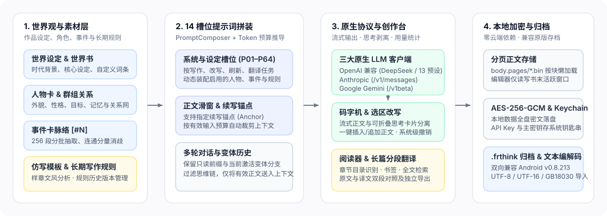

# Frthink for iOS

[](https://developer.apple.com/ios/)
[](https://swift.org)
[](https://github.com/Reylumina/Frthink-iOS/actions/workflows/ios.yml)

Frthink for iOS（下称 **Frthink**）是基于 Android 应用 Frthink v0.8.213（由 Fr33 开发，包名 `com.frthink.app`）开发的非官方 SwiftUI 移植版，与原作者无隶属关系；原应用及其提示词的版权均归原作者所有。

Frthink 面向中文长篇小说写作，提供码字机流式续写、世界书、人物卡、事件卡、仿写模板、长期写作规则、语料收集库、阅读器与原文翻译。

## 架构与功能



### 1. 世界观与素材
- **世界设定与世界书**：管理作品时代背景、核心设定及自定义世界书词条；支持通过“共享宇宙”跨书稿复用通用设定。
- **人物卡与群组**：支持从正文或对话自动抽取人物卡、分批刷新与关系合并，也可手动编辑角色外貌、性格、目标与记忆。
- **事件卡**：按时序归纳正文剧情事件，支持从正文增量刷新事件脉络。
- **仿写模板与长期规则**：支持从样章分析生成仿写模板，或整理作品长期写作规则并保存历史版本。

### 2. 提示词拼装
- **任务模板装配**：按续写、改写、世界刷新、规则归纳、翻译等任务拼装对应内容，可在写作台素材面板随时开关参与本轮拼装的人物卡、事件卡、模板与规则。
- **正文滑窗与续写锚点**：支持在正文任意段落设置续写锚点，按输入预算裁剪正文窗口与多轮对话历史。

### 3. 模型接口与功能
- **流式续写与思维链**：支持流式生成正文与独立折叠的思考过程卡片；同一轮指令可多次重生成并左右切换候选变体。
- **选区改写与正文编辑**：支持选中正文片段按指令局部改写、插入或追加至正文，支持系统撤销与重做。
- **阅读器、翻译与语料库**：阅读器支持章节目录识别、全文搜索、书签定位与排版调节；翻译页支持分段原文与译文对照翻译及导出；语料库支持按分类收藏和检索描写片段。

### 4. 本地存储与备份
- **本地加密**：本地书稿正文分页、世界设定、翻译原文与译文均使用 `AES-256-GCM` 加密存储，主密钥与 API Key 保存在 iOS 系统 Keychain。
- **导入与导出**：兼容原版 `.frthink` 备份归档导入与导出；正文与译文支持 UTF-8、UTF-16、GB18030 编码文本导入及 `.txt` 导出。

## 模型供应方

在设置页配置服务地址与模型。API Key 保存在 iOS 系统 Keychain 中，不写入普通文件或备份存档。支持服务端返回用量与本地估算结合的累计 Token 统计。

| 供应方 | 默认地址 | 说明 |
|---|---|---|
| DeepSeek | `https://api.deepseek.com` | 支持 `deepseek-chat` / `deepseek-reasoner` 与思维链分流 |
| Anthropic | `https://api.anthropic.com` | 原生 `/v1/messages` 协议，支持 Extended Thinking |
| Google Gemini | `https://generativelanguage.googleapis.com/v1beta` | 原生 REST 协议，支持 `thinkingConfig` |
| OpenRouter | `https://openrouter.ai/api/v1` | 支持统一 `reasoning` 参数与多模型路由 |
| OpenAI 兼容 | 自定义或内置预设 | 内置 Kimi、GLM、Qwen、豆包、混元、MiniMax、OpenCode Go、Ollama Cloud、Grok、Mistral 等预设 |

## 构建与安装

### 环境要求
- iOS 17.0 及以上（iOS 26 及以上启用原生 Liquid Glass 材质，iOS 17–25 使用系统毛玻璃材质）
- Xcode 16.0 及以上，无第三方依赖

### 编译

```bash
git clone https://github.com/Reylumina/Frthink-iOS.git
cd Frthink-iOS

xcodebuild -project ios/Frthink.xcodeproj -scheme Frthink \
  -destination 'generic/platform=iOS Simulator' build
```

GitHub Actions 工作流（[`.github/workflows/ios.yml`](.github/workflows/ios.yml)）可直接构建未签名安装包 `Frthink-unsigned.ipa`，通过 AltStore、SideStore、Sideloadly 或 TrollStore 安装至设备。

## 署名

| 项目 | 内容 |
|---|---|
| 原作 | Fr33 |
| 原应用 | Frthink v0.8.213（Android，`com.frthink.app`） |
| 原版署名 | `Power by Fr33` |

原版设置页中的版本行和 `Power by Fr33` 署名行在 Frthink 中原样保留。
